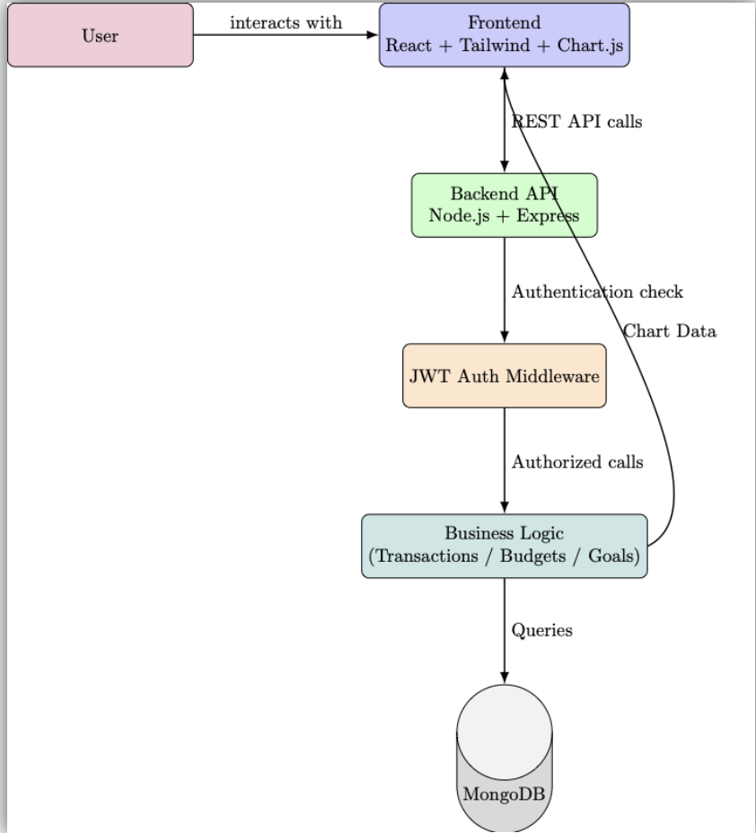
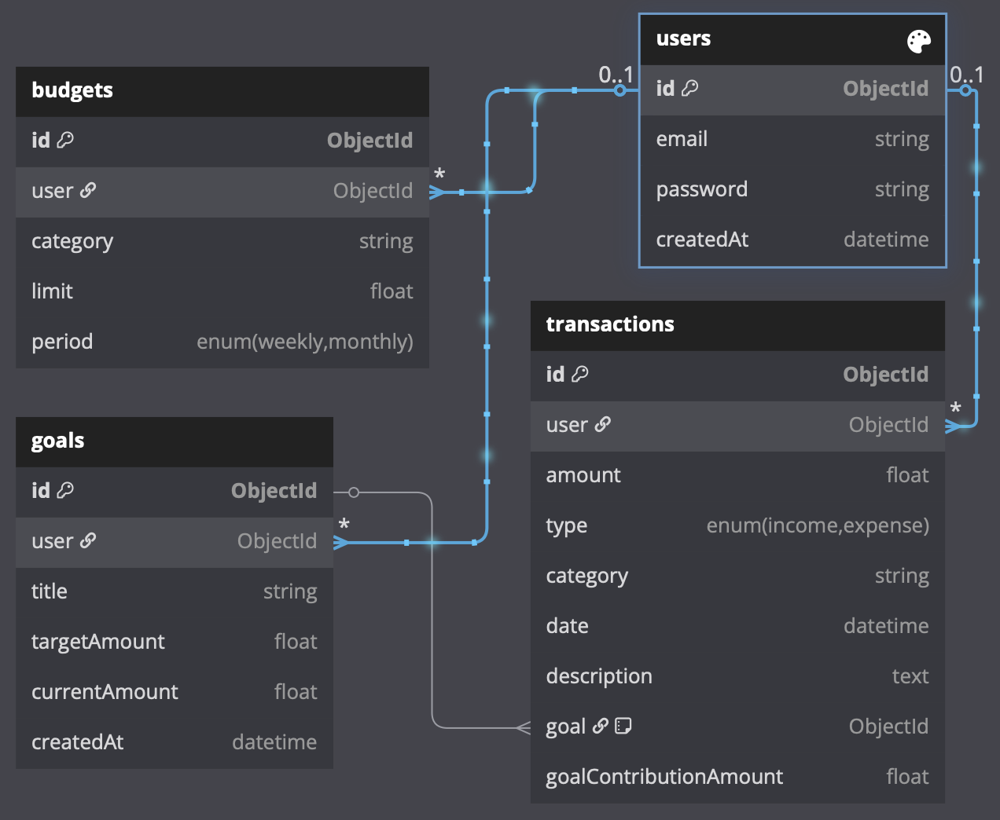

# FINO – Personal Finances Tracker

**FINO** is a full-stack personal finance platform built to help users gain control over their spending habits. It enables easy tracking of expenses, budget planning, and visual insights into financial goals—all in one place.

## Table of Contents

1. [Features](#features)  
2. [Tech Stack](#tech-stack)  
3. [System Architecture](#system-architecture)  
4. [Database Schema](#database-schema)  
5. [Installation](#installation)  
6. [Usage Workflow](#usage-workflow)  
7. [Future Improvements](#future-improvements)  
8. [Live Website](#live-website)  
## Features

- User authentication and secure login  
- Add, edit, and delete financial transactions manually
- Categorized income and expenses  
- Set monthly budgets and monitor goal progress  
- Read suggested Finance related tips and plan accordingly in app
- Real-time visualizations using Graphs (day, week, month and year filters) and Pie, Bar Charts.  
- Clean and responsive UI  
- Personalized dashboards and financial summaries  


## Tech Stack

**Client:** React, TailwindCSS, Chart.js  

**Server:** Node.js, Express.js  

**Database:** MongoDB  

**Authentication:** JWT  


## System Architecture


## Database Schema


## Installation

1. Clone the repo
```bash
  git clone https://github.com/varunbalaji167/FINO
  cd FINO
```

2. Set up environment variables
- In root of server
```bash
MONGO_URL=<your-mongodb-url>
JWT_SECRET=<your-secret>
PORT:3000
```    
- In root of client
```bash
VITE_API_BASE_URL=http://localhost:3000/api/
```

3. In split terminals
```bash
    cd server
    npm install
    nodemon server.js
```
```bash
    cd client
    npm install
    npm run dev
```

## Usage Workflow

- Sign up and log in securely  
- Add income or expense transactions  
- Assign categories like Food, Rent, Salary, etc.  
- Set monthly budgets and track against actual spending 
- Set your long term and short term financial goals 
- View summary charts and gain financial insights  


## Future Improvements

- Recurring transaction support  
- Email reminders for budget limits   
- AI insights for saving suggestions 
## Live Website

**Live URL**: [FINO](https://fino-sigma.vercel.app/)